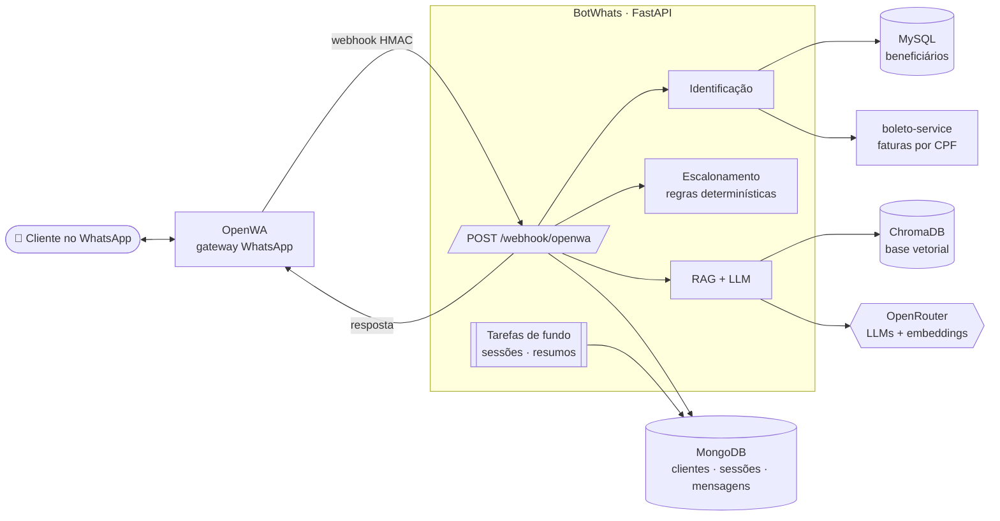
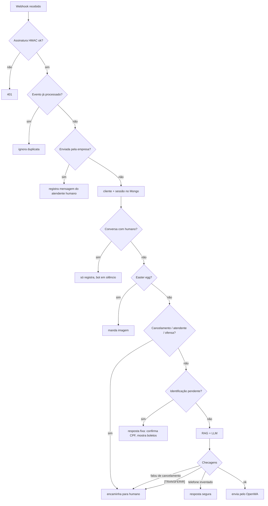
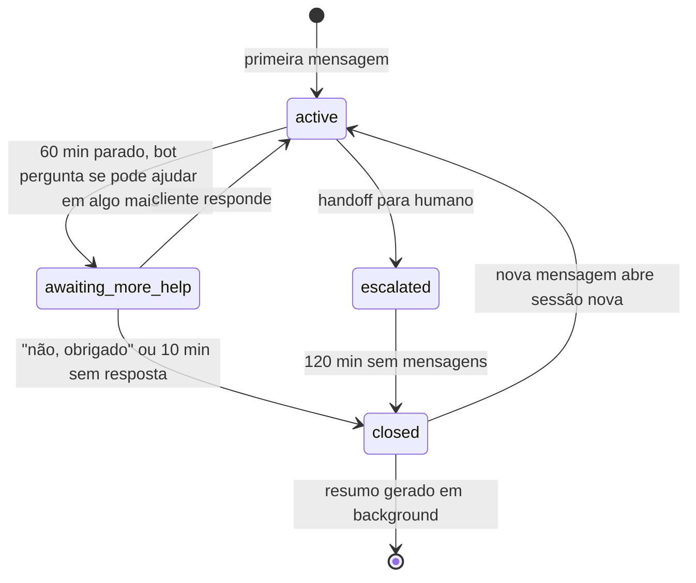

<div align="center">

# 🤖 BotWhats

**Atendente virtual de WhatsApp com RAG, identificação de clientes e passagem para humano**

Um bot de atendimento completo, do webhook ao deploy: entende a pergunta,
busca a resposta numa base de conhecimento, identifica quem está falando,
mostra boletos em aberto e sabe a hora de chamar uma pessoa.


</div>

---

## 💬 Como é uma conversa

```text
👤 oi
🤖 Oi, tudo bem? Eu sou a Iza, assistente virtual da Acme Benefícios. 😊
   Estou falando com Ana Souza, CPF final **38? Se for você, é só responder 'sim'.
👤 sim
🤖 Perfeito, Ana! Identidade confirmada.
   Identificamos no sistema que há um boleto em aberto:
   Vencimento 10/10/2026, R$ 351,87 (a vencer)
   https://...
👤 qual o whatsapp da minha operadora?
🤖 O WhatsApp da Vida Plena Saúde é (11) 90000-0101, e por lá você também acessa a carteirinha digital.
👤 quero cancelar meu plano
🤖 Entendi! Para cuidar disso com toda a atenção que você merece, vou te
   encaminhar agora para um dos nossos atendentes...          ← bot sai, humano assume
```

O exemplo usa a empresa fictícia **Acme Benefícios**, que já vem configurada.
Nome do bot, empresa, contatos e base de conhecimento mudam pelo `.env` e por
arquivos `.md`, sem mexer no código.

## ✨ Destaques

| | |
|---|---|
| 🧠 **RAG de verdade** | 46 artigos em Markdown → chunks por seção → embeddings → ChromaDB. A ingestão é **incremental** (hash por chunk): só reindexa o que mudou e apaga o que saiu da base. |
| 🛡️ **Anti-alucinação em camadas** | O prompt obriga a responder só com o contexto. Depois disso, o código **bloqueia qualquer telefone que não esteja no contexto** e troca a resposta por uma segura. |
| 🔁 **Fallback de modelos** | Lista de LLMs em ordem de preferência. Se um cai, dá rate limit ou volta vazio, o próximo assume. |
| 🪪 **Identificação segura** | Acha o cliente pelo telefone (últimos 8 dígitos) ou CPF e **pede confirmação** antes de mostrar qualquer dado. Visitante nunca vê histórico de outro cliente. |
| 🙋 **Handoff para humano** | Por regra (cancelamento, ofensa, "quero um atendente") ou por decisão do LLM (`[TRANSFERIR]`). Enquanto o humano atende, o bot fica em silêncio e registra o que o atendente digita. |
| ⏱️ **Sessões com ciclo de vida** | Máquina de estados em background: pergunta "posso ajudar em algo mais?", encerra sozinho e **resume o atendimento com LLM** para dar contexto ao próximo. |
| 🕗 **Horário comercial** | Fora do expediente, o pedido de cancelamento recebe o passo a passo pelo app em vez de ir para uma fila vazia. |
| 🔐 **Webhook blindado** | Assinatura **HMAC-SHA256** com `compare_digest` e **idempotência** por evento (o WhatsApp reentrega). |
| 🐳 **Deploy de um comando** | Script idempotente que clona o OpenWA, gera segredos, pareia o WhatsApp por código e registra o webhook. |
| 🐱 **Easter eggs** | Mande "gato", "passarinho" ou "pokemon" e veja. |

## 🏗️ Arquitetura



### O caminho de uma mensagem



**Princípio de design:** tudo que não pode dar errado (cancelamento, identidade,
boletos, horário) é **código determinístico**. O LLM só entra para redigir
respostas de dúvidas, e mesmo assim passa por checagens antes de sair.

### Ciclo de vida da sessão



## 🧰 Stack

| Camada | Tecnologia | Por quê |
|---|---|---|
| API | **FastAPI** + **Uvicorn** | async de ponta a ponta; o webhook não pode travar esperando o LLM |
| WhatsApp | **OpenWA** (whatsapp-web.js) | gateway self-hosted com webhook e API REST |
| LLM | **OpenRouter** | um só endpoint para vários modelos, com fallback |
| Embeddings | `text-embedding-3-small` | barato e bom em português |
| Vetores | **ChromaDB** (persistente) | roda embutido, sem servidor extra |
| Conversas | **MongoDB** via **motor** | documentos flexíveis para sessões, mensagens e escalonamentos |
| Cadastro | **MySQL** via **aiomysql** (pool) | base de beneficiários, só leitura |
| HTTP | **httpx** async, cliente compartilhado | reaproveita conexões com OpenWA, OpenRouter e boleto-service |
| Dependências | **uv** | lockfile reprodutível e build rápido no Docker |
| Infra | **Docker** multi-stage, usuário não-root, healthcheck | imagem enxuta e segura |
| Túnel dev | **cloudflared** quick tunnel | webhook público em segundos para testar no celular |

## 🗂️ Estrutura

```
BotWhats/
├── app/
│   ├── main.py              FastAPI, lifespan, /health
│   ├── api/webhook.py       orquestra o fluxo de cada mensagem
│   ├── core/                config, conexões compartilhadas, HMAC
│   ├── models/              payloads Pydantic do OpenWA
│   └── services/            rag · identification · escalation · session
│                            summaries · boletos · business_hours · easter_eggs
├── prompts/                 ✏️ persona e regras do bot (system.md, summary.md)
├── knowledge_base/          ✏️ artigos .md que viram a base vetorial
├── scripts/                 ingest · dev · deploy · túnel · webhook
├── bancoFake/               MySQL de demonstração com beneficiários fictícios
├── docker-compose.yml       bot + Mongo + MySQL
└── docker-compose.dev.yml   OpenWA
```

Cada pasta tem um README próprio com os detalhes.

## 🚀 Rodando

**Pré-requisitos:** Docker e uma chave do [OpenRouter](https://openrouter.ai).

```bash
git clone https://github.com/RichardtJustke/BotWhats.git && cd BotWhats
./scripts/deploy-openwa-chat.sh
```

O script faz tudo: sobe o OpenWA, gera os segredos, sobe bot + Mongo + MySQL,
pede o número para **parear o WhatsApp por código** e registra o webhook. É
idempotente, então pode rodar de novo quando quiser.

<details>
<summary><b>Modo desenvolvimento (hot reload + túnel)</b></summary>

Precisa também de [uv](https://github.com/astral-sh/uv), `cloudflared` e `jq`.

```bash
cp .env.example .env               # preencha OPENWA_API_KEY, OPENROUTER_API_KEY, MYSQL_PASSWORD
uv sync
uv run python scripts/ingest.py    # indexa a base de conhecimento
./scripts/dev.sh                   # API com --reload + túnel + webhook apontado
```

`Ctrl+C` derruba API e túnel juntos.
</details>

## 🎨 Personalizando

Tudo que é conteúdo fica fora do código:

| O quê | Onde |
|---|---|
| Nome do bot, empresa, e-mails, telefones, links do app | `.env` (`BOT_NAME`, `COMPANY_NAME`, `SUPPORT_EMAIL`...) |
| Personalidade, tom, formato e regras do bot | [`prompts/system.md`](prompts/system.md) |
| O que o bot sabe responder | [`knowledge_base/`](knowledge_base/README.md), um `.md` por assunto |
| Horário de atendimento humano | `ATENDIMENTO_DIAS`, `ATENDIMENTO_INICIO`, `ATENDIMENTO_FIM` |
| Modelos de LLM (em ordem de preferência) | `OPENROUTER_MODELS` |

Os arquivos de `prompts/` e `knowledge_base/` aceitam placeholders como
`{{empresa}}`, `{{bot}}` e `{{email_atendimento}}`, preenchidos com o `.env`.
Depois de editar a base, rode `scripts/ingest.py`: só os trechos alterados
são reindexados.

> **Por que o prompt não fica na `knowledge_base/`?** Tudo que está lá é
> fatiado e só entra na conversa quando a busca encontra um trecho parecido.
> A persona e as regras precisam estar em **toda** resposta, então vão direto
> no system prompt.

<details>
<summary><b>Todas as variáveis de ambiente</b></summary>

| Variável | Obrigatória | Descrição |
|---|---|---|
| `OPENWA_API_URL` | | API do OpenWA (padrão `http://localhost:2785/api`) |
| `OPENWA_API_KEY` | ✅ | chave de API do OpenWA |
| `OPENWA_WEBHOOK_SECRET` | | segredo HMAC do webhook (mín. 16 caracteres) |
| `OPENWA_WEBHOOK_EVENTS` | | eventos assinados; inclua `message.sent` para registrar o atendente |
| `OPENROUTER_API_KEY` | ✅ | chave do OpenRouter |
| `OPENROUTER_MODELS` | | modelos em ordem de preferência, separados por vírgula |
| `MONGO_URI` / `MONGO_DB_NAME` | | Mongo (padrão `mongodb://localhost:27018` / `chat_service`) |
| `MYSQL_HOST` / `MYSQL_PORT` / `MYSQL_USER` / `MYSQL_DB` | | MySQL de beneficiários |
| `MYSQL_PASSWORD` | ✅ | senha do MySQL |
| `MYSQL_POOL_MIN` / `MYSQL_POOL_MAX` | | tamanho do pool de conexões |
| `SESSION_TIMEOUT_MINUTES` | | parado até perguntar "posso ajudar em algo mais?" (60) |
| `SESSION_CLOSE_MINUTES` | | sem resposta até encerrar (10) |
| `ESCALATION_RELEASE_MINUTES` | | conversa com humano volta para o bot após esse tempo parada (120) |
| `ATENDIMENTO_DIAS` / `ATENDIMENTO_INICIO` / `ATENDIMENTO_FIM` | | horário com atendente, fuso de Brasília |
| `BOLETO_SERVICE_URL` / `BOLETO_SERVICE_API_KEY` | | serviço de faturas por CPF; chave vazia desliga |
| `BOT_NAME` / `COMPANY_NAME` / `COMPANY_APP_NAME` | | identidade do bot e da empresa |
| `SUPPORT_EMAIL` / `OMBUDSMAN_EMAIL` | | e-mails de atendimento e ouvidoria |
| `SUPPORT_PHONE` / `SUPPORT_WHATSAPP` | | contatos da empresa |
| `APP_STORE_URL` / `PLAY_STORE_URL` | | links do app nas lojas; vazios não aparecem |

</details>

## 🛠️ Como foi construído

Construí o projeto em duas semanas de setembro de 2026, em incrementos que
sempre deixavam o bot funcionando:

| Data | Etapa |
|---|---|
| **16–17/09** | Esqueleto FastAPI recebendo o webhook do OpenWA, com validação **HMAC** da assinatura. |
| **21/09** | Pipeline completo: modelos Pydantic do payload, clientes e histórico no Mongo, **banco de beneficiários fake**, base de conhecimento e primeiro **script de ingestão** no Chroma. |
| **23/09** | **RAG** respondendo de verdade, busca de beneficiário no MySQL, envio pelo OpenWA. Depois: **identificação por telefone/CPF com confirmação**, **escalonamento** por regras, Dockerfile e entrypoint que indexa a base no boot. |
| **24/09** | Pronto para deploy: **recursos compartilhados** (pool MySQL, cliente HTTP, Chroma) no lifespan, **fallback entre modelos**, **máquina de estados de sessão** em background, `dev.sh` com túnel automático e os **easter eggs** 🐱. |
| **25/09** | Infra: `docker-compose` do OpenWA, **script de deploy idempotente** com pareamento por código e túnel como serviço systemd. |
| **28/09** | Qualidade da conversa: registro do que o **atendente humano** digita, **resumos de atendimento com LLM**, ingestão **incremental por hash** e **bloqueio de telefone inventado**. |
| **29/09** | **Boletos em aberto** na confirmação do CPF, **horário comercial** e fluxo de cancelamento fora do expediente, prompt reestruturado e documentação de cada pasta. |

### Decisões e aprendizados

- **LLM redige, código decide.** Cancelamento passa por regex sobre texto
  normalizado (sem acento) *antes* do LLM, e a resposta do LLM é checada *de
  novo* depois. Um falso positivo custa pouco; um bot "conduzindo"
  cancelamento não pode acontecer.
- **Não confie no telefone que o modelo escreveu.** Modelos pequenos
  "completam" números com muita convicção. Comparar os dígitos da resposta com
  os do contexto resolveu isso com algumas linhas.
- **Webhooks repetem.** Sem a chave de idempotência, o mesmo "oi" gerava duas
  respostas.
- **`@lid` do WhatsApp.** Contatos novos chegam com um ID que não é o
  telefone. O bot resolve o número real pelo OpenWA e usa `@c.us` para enviar
  mídia, porque o whatsapp-web.js quebra com `@lid`.
- **Ingestão incremental.** Cada chunk guarda o hash do conteúdo; editar um
  artigo reindexa só aquela seção, então o container sobe rápido mesmo
  rodando a ingestão no boot.

## 🗺️ Próximos passos

- [ ] Testes automatizados do fluxo do webhook (pytest + Mongo/MySQL em container)
- [ ] Feriados no horário comercial
- [ ] Painel para a equipe ver a fila de escalonamentos
- [ ] Migração opcional para a **WhatsApp Cloud API** oficial (botões e templates)
- [ ] Remover a dependência `google-genai`, que não é usada
- [ ] Unificar `scripts/server-tunnel.sh` e `scripts/server_tunnel.sh`

---

<div align="center">
Feito por <a href="https://github.com/RichardtJustke">Richardt Justke</a>
</div>
